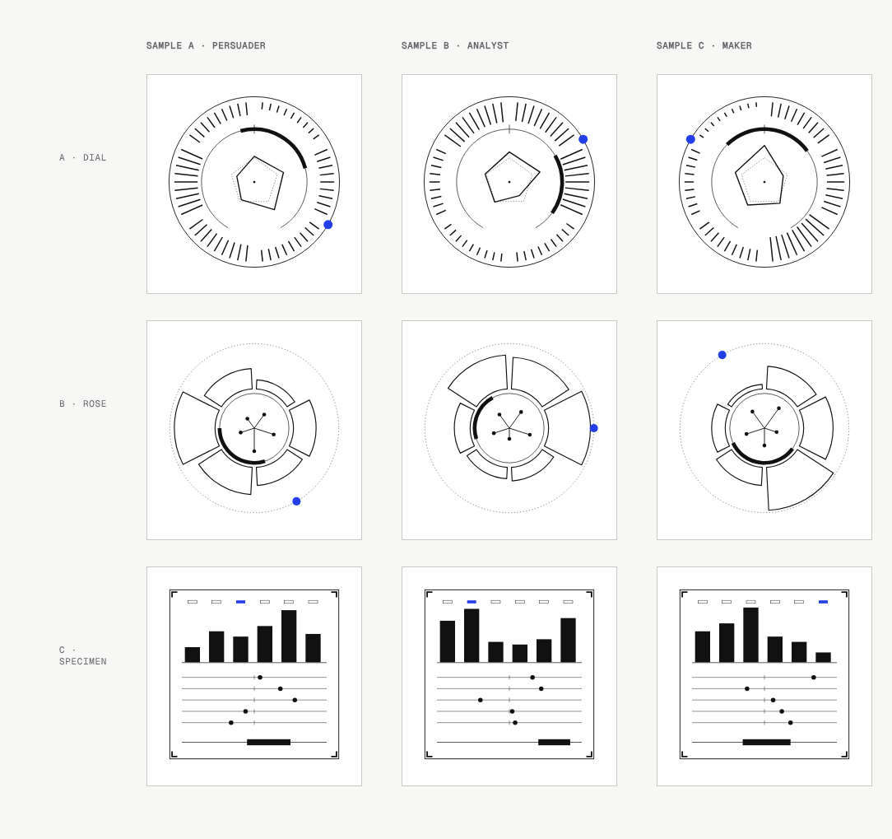
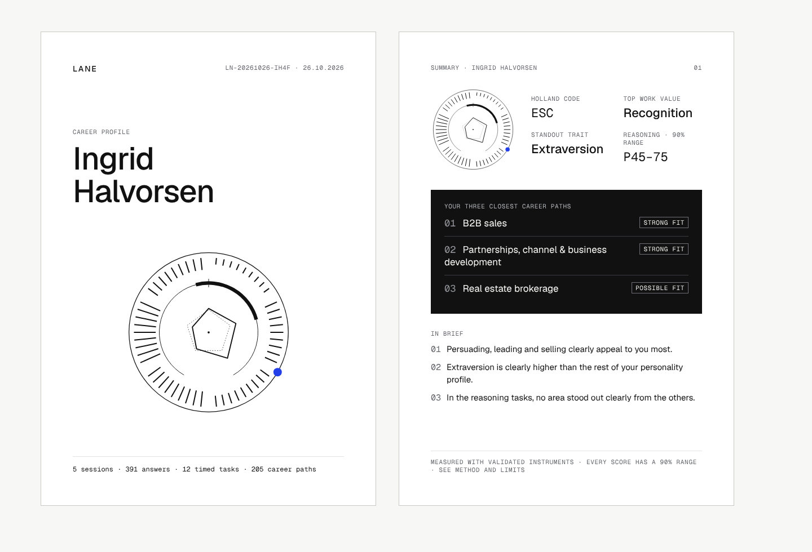
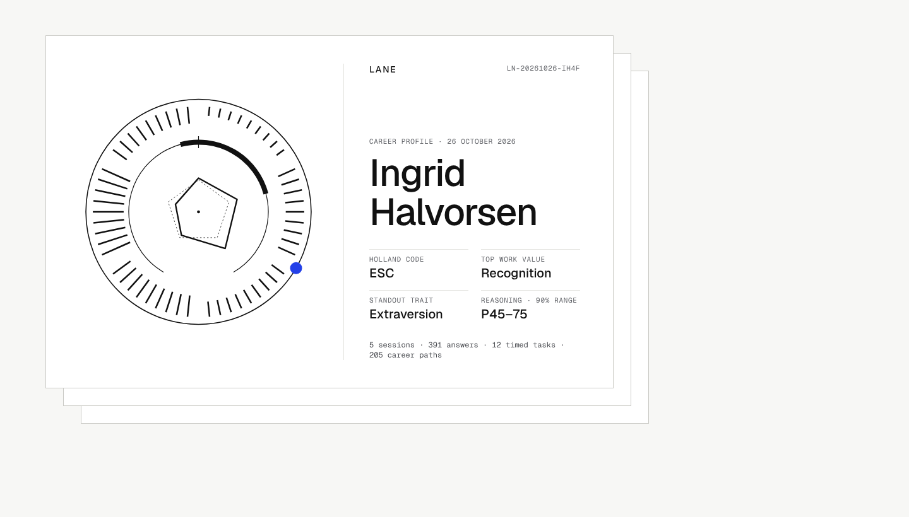

# Design direction: perceived value (desktop)

Status: **proposal, waiting for your go-ahead.** Nothing in `src/` has changed for this pass yet.

## 1. Protected paths (no changes in this pass)

`git diff` on these must stay empty for the whole brand pass:

| What | Paths |
|---|---|
| Scoring | `src/lib/scoring/**` |
| Items, item order, sessions | `assessment/items/**`, `assessment/battery_manifest.json`, `src/lib/bank/**` |
| Generators | `assessment/generators/**` |
| Norms and calibration | `assessment/calibration/**`, `src/lib/scoring/cognitive/**` |
| Matching logic | `src/lib/matching/**` |
| Taxonomy data | `taxonomy/**`, `src/lib/taxonomy/**`, `scripts/gen-taxonomy-types.mts` |
| Data schemas | `src/lib/db/schema.ts`, `drizzle/**`, `src/lib/report/schema.ts`, `src/lib/report/facts.ts` |
| Session flow and timed tasks | `src/lib/assess/**`, `src/components/assess/tasks/**`, `src/components/assess/hooks.ts`, `src/components/assess/api.ts` |

`src/components/assess/SessionRunner.tsx` is the one shared file. Only `SessionOutro` changes there; it renders after the last trial is saved, so it can't affect trial timing. I'll measure timing before and after with `TIMING_LOG`, the same way as D51.

Note: the band label "Possible fit" (last pass) lives in `src/lib/matching/fit.ts`. I'll move the display labels out to `src/lib/lanes/labels.ts`, so matching is untouched from then on.

## 2. Routes today

Marketing: `/`, `/method`. Auth: `/login`, `/signup`. Onboarding: `/start`. App: `/assess`, `/assess/[session]`, `/profile`, `/lanes`, `/settings`. System: `/system`. Images: `/opengraph-image`, `/twitter-image`. API: `/api/assess/[session]/{answer,retake,state,task}`, `/api/export`, `/api/public/job-search`, `/api/taxonomy/search`. Redirects: `/sprints*` and `/evidence*` → `/lanes`; `/lanes/:lane/plan` → `/lanes?lane=:lane`.

New in this pass: `/sample` (full fictional report), `/profile/print` (the A4 print view), `/share` (share-card builder), `/api/share` (PNG).

## 3. Principles, in my words

1. **The report is the product.** Every screen either shows the report, shows it filling in, or points to it. The landing page sells by showing a real-looking document, not by arguing.
2. **Precision is visible, not apologised for.** Intervals, bands and the provisional marker carry the uncertainty graphically. The prose says what is clearly true once, plainly. Caveats live in one chapter and are referenced, not repeated.
3. **One object per screen.** Fewer, bigger things: a cover, a sheet, a chart. Each screen has one inverted ink panel for its single most important result.
4. **It's theirs.** Name, report ID, date and the Profile Mark appear together, like a signed document. The mark is the only "generated" image, and every line of it is a score.
5. **Earned moments only.** Nothing reacts during measurement. The one celebratory moment is the reveal after S5, and it plays once.
6. **Quiet craft.** Hairlines, tabular numerals, white paper on a warm canvas. Lab decoration is halved: § numbers only for navigation, FIG captions only on real figures, version strings only in the method chapter.

## 4. The Profile Mark: three options

Same three fictional profiles in each row. A: Enterprising-led persuader. B: Investigative/Conventional analyst. C: Artistic maker. Standalone SVGs are in `design/direction/mark-*.svg`.



What each element encodes (the same in all three):

| Element | Data | Scale |
|---|---|---|
| Interests (6) | O*NET raw sum per RIASEC area | 10–50; 10 is zero length |
| Personality (5) | Domain z (self-relative now; population z once norms exist) | −2.5…+2.5; a dashed reference marks 0 |
| Reasoning | General reasoning 90% percentile band | 0–100 (upper bound capped at 99, as displayed) |
| Top work value | Rank 1 of the six WIL values | One of six fixed positions |

- **A · Dial.** An instrument face. Interests are tick sectors on the bezel (6 × 9 ticks, length = score). Personality is the inner pentagon, with a dashed pentagon at your own average. Reasoning is a 300° gauge arc with a tick at the 50th percentile. The top value is one accent dot on the bezel. Reads like a watch dial or a lab instrument, and stays legible from 48 px to 400 px.
- **B · Rose.** A scientific glyph. Interests are a ring of wedges (a Nightingale rose), personality five lollipop spokes, reasoning a band on the inner circle, the value an accent dot on a dotted orbit. More expressive and more distinctive between people, but the wedges read as "chart" more than "mark" and get busy below 80 px.
- **C · Specimen.** A square seal, read top to bottom: value cells, interest bars, five personality strip tracks, a reasoning track. The most literal and the easiest to explain, but it looks like a small dashboard, not an ownable symbol, and it doesn't hold up as an icon.

Determinism: each option is a pure function of those 17 numbers (6 + 5 + 2 + 1, missing parts drawn as empty tracks), with no randomness and no time. Unit tests: same input gives a byte-identical SVG, and the three sample profiles (plus 200 random pairs) give different SVGs.

**Recommendation: A · Dial.** It is the most "precision instrument", works at every size the brief lists (cover, summary, hub, share card, favicon-scale), and the legend is short: "outer ticks = interests, shape = personality, arc = reasoning range, blue dot = top value." B is the runner-up if you want more variety between people.

## 5. Cover and summary sheet: two directions

**Direction 1 · Dossier.** Portrait A4 sheets, side by side on the canvas: cover (wordmark, ID and date, large name, "Career Profile", large mark, effort line), then the one-page summary sheet (mark and four figures, the inverted ink panel with the top 3 career paths, three "In brief" lines, a one-line method footer). It maps 1:1 to the PDF and prints as is.



**Direction 2 · Instrument.** A landscape cover with the mark as the hero, on an offset paper stack. The name and four figures are on the right. More "Apple product shot", more striking on the landing page, but it doesn't map to A4. The PDF would need a separate portrait layout.



**Recommendation: Direction 1 for the report and PDF.** On the landing page and `/sample`, show those same two sheets as an offset stack (Direction 2's staging), so there is one design and one source of truth.

## 6. Token changes

Additions only; existing tokens keep their values.

```css
:root {
  --paper: #ffffff;              /* chapter and sheet surface (= --surface today) */
  --paper-edge: #c9c9c4;         /* the sheet's hairline border (= --rule-strong) */
  --panel: #111111;              /* the one inverted panel per screen */
  --panel-ink: #f7f7f5;
  --panel-ink-2: #b3b5ba;
  --panel-rule: #3a3c41;
  /* "Your data" ramp, from the accent. Grey (--data-band, --data-ref) stays "population". */
  --you-1: #eef1fe;  --you-2: #c9d0fa;  --you-3: #8d9cf3;  --you-4: #5a6ff0;  --you-5: #2340e8;
}
dark {
  --paper: #16171a;  --paper-edge: #3a3c41;
  --panel: #ededea;  --panel-ink: #111111;  --panel-ink-2: #47494e;  --panel-rule: #c9c9c4;
  --you-1: #1a1f3d;  --you-2: #27306b;  --you-3: #3e4fb0;  --you-4: #5468e6;  --you-5: #6b80ff;
}
--text-numeral: 56px / 56px, tabular, -0.03em   /* large Geist Mono figures */
--dur-reveal: 400ms; stagger 60ms               /* reveals only */
```

Contrast checks before use: `--you-4` and `--you-5` are AA for text on white; `--you-1` to `--you-3` are fills only. The inverted panel in dark mode becomes a light panel, which keeps it "the inverted one".

## 7. Facts to settle before building

- **The effort line uses real counts, not the brief's example.** The bank schedules 288 questionnaire items in S1–S2, plus the card sorts, 3 effort checks, 18 judgment scenarios, 4 idea tasks and 29 history questions in S5, and 12 tasks in S3–S4 (reasoning, memory and speed tasks, plus the balloon and delay-choice tasks, which aren't timed ability tests). The report will count the person's own stored answers and task trials. The "391 answers · 12 timed tasks" in the mockups above is placeholder text. The landing line will use the bank's fixed counts, computed from the bank at build time, never hard-coded. Before any count goes into copy, I'll confirm from the task renderers which tasks are actually timed.
- **Name:** `BRAND.name = "Lane"` and `<Wordmark/>` in `src/lib/brand.ts`, used everywhere the name appears (including metadata, OG images and emails).
- **Auto-regenerating the written report** on load calls the Anthropic API without a fresh click. Today the person ticks a consent box each time. Proposal: consent is given once (stored with the account), and later regenerations reuse it, with a line in Settings to withdraw it. Without stored consent, the stale report isn't shown; instead there's a single "Update your written report" action. Please confirm.
- **Share card:** opt-in, first name only. Reasoning and personality appear only if toggled on, and the PNG is generated on request and not stored.

## 8. Phases after your go-ahead

1. Tokens, `BRAND`/`<Wordmark/>`, `<ProfileMark/>` with legend and tests.
2. Report: cover, summary sheet, TOC with chapter rail, chapters, method and limits, auto-refresh, A4 print view and "Download PDF".
3. Career map: match overlay, trait-to-career connection view, the #1 card on paper.
4. Milestones: compiling and reveal screen, session completion previews, hub miniature.
5. Share card and OG image from the same component.
6. Landing page and `/sample`.
7. `REPORT_TIER` flag (default `full`).
8. Performance: cached computation, streamed shell, layout-exact skeletons, LCP < 1.5 s.

Screenshots for each phase go into `design/after/<phase>/` at 1440×900 and 1280×800, light and dark. Baseline screenshots are in `design/baseline/`.
